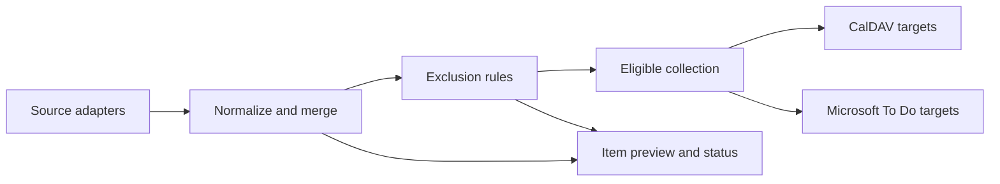

# Architecture

How AutoTrack is built. What it does from the user's side is in [design.md](design.md).

## Stack

| Layer | Choice |
| --- | --- |
| Language | TypeScript, Node.js |
| Backend | Fastify, bundled with esbuild |
| Storage | PostgreSQL through Prisma |
| Web UI | Served by the same process; framework to be chosen |
| Tests and lint | Vitest, ESLint |
| Deployment | Docker Compose (app + database) |

One process serves the API and the web UI, runs the scheduler, and owns all credentials. The UI only talks to the API.

## Modules

| Module | Responsibility |
| --- | --- |
| `api` | Validate configuration, drive connection setup flows, expose run state and item previews. |
| `sources` | One adapter per platform. Verify account identity, fetch items, maintain auth state, report health. |
| `rules` | Normalize items, merge by identity, evaluate exclusion rules with bounded regex execution. |
| `sync` | Scheduler, run lifecycle, per-target publication, mapping upkeep, result recording. |
| `targets` | One adapter per service. Validate connections, list destinations, create and update managed tasks. |
| `storage` | Prisma models and queries for connections, items, rules, mappings, and runs. |
| `web` | The single-page interface. |

Adapters implement a shared contract and know nothing about each other. A source produces normalized items; a target consumes the eligible collection. Neither builds the other's data.



## Data model

| Entity | Key fields | Uniqueness |
| --- | --- | --- |
| SourceConnection | platform, instance URL, remote account id, label, credentials, status, last fetch | (platform, instance, account) |
| Item | connection, type, remote id, title, course, due (with timezone), URL, availability, last seen | (connection, type, remote id) |
| Rule | name, enabled, conditions (source, course, type, title text, title regex) | name |
| TargetConnection | service, label, destination id and name, credentials, enabled, status, last result | (service, account, destination) |
| Mapping | item, target, remote task id, version tag, state | (item, target) |
| Run | started, finished, trigger, per-connection results and errors | |

Credentials (cookies, CalDAV passwords, MSAL token caches) are stored by the backend and never returned by the API. Logs and previews omit them. The deployment is responsible for protecting the database and for any network-level access control; the app has no user accounts.

## Run lifecycle

1. Acquire the single run lock. If held, a manual request returns "already running" and a scheduled tick is skipped.
2. For each enabled source: fetch all pages. On any failure keep the previous snapshot and mark the source stale or expired. On success upsert items, mark seen items present and unseen items missing.
3. Evaluate rules over all items and compute the eligible collection.
4. For each enabled target, independently: create tasks for eligible items without a mapping, update tasks whose source fields changed, skip the rest. Use the target's version tag to avoid overwriting a concurrent completion change. Record created, updated, failed, and removed-in-target counts.
5. Save the run and release the lock.

A target failure never rolls back another target. Retrying a target reruns step 4 for that connection only. Mappings are the source of truth for "managed by AutoTrack"; tasks without a mapping are never touched.

## Layout

```text
src/
  main.ts          entry point
  api/
  sources/         canvas/ (later prairielearn/, prairietest/)
  targets/         caldav/, mstodo/
  rules/
  sync/
  storage/
  web/
prisma/
  schema.prisma
```

## Acceptance checklist

- Repeated and overlapping refreshes produce exactly one managed task per item in each target, including after a restart.
- Adding the same account on the same instance twice is rejected; distinct accounts and instances are accepted.
- Every enabled target receives the same eligible collection.
- Conditions use AND within a rule and OR across rules; preview explains matches; invalid or slow patterns never block a run.
- Excluding an item keeps its tasks; removing the exclusion resumes updates without duplicates.
- Completing a task in one target survives later source updates and leaves other targets and the source unchanged.
- Expired cookies, failed fetches, partial pages, missing items, and a changed query window all keep existing tasks and report accurate status.
- A failed target can be retried without duplicating tasks or disturbing another target's successful run.
- No API response, preview, or log line contains a credential.
