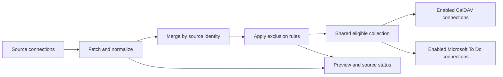

# Architecture

This document describes the intended first release. All modules and behavior are planned; there is no executable implementation yet.

## Runtime and modules

AutoTrack will serve one student per instance while allowing multiple source and target connections. The backend will own credentials, refresh jobs, normalization, and synchronization. The frontend will configure the backend and display its state.

| Module | Responsibility |
| --- | --- |
| Web frontend | Configure connections, exclusion rules, and schedules; trigger refreshes; display status and previews. |
| Configuration and management API | Validate configuration, coordinate connection authentication, and expose run state and preview data. |
| Source adapters | Validate remote identity, fetch items, maintain authentication state, and report source health. |
| Normalization and exclusion rules | Produce consistent items, deduplicate by source identity, and determine which items are eligible for publication. |
| Scheduler and synchronization engine | Coordinate scheduled and manual work, maintain target mappings, and record results independently for each connection. |
| Target adapters | Validate connections, select task collections, create and update managed tasks, and read their current completion state. |
| Storage adapters | Persist configuration, credentials, cached items, rules, mappings, and run state behind a common interface. |

An illustrative future layout is shown below. These directories are not created at this stage.

```text
apps/
  web/
  backend/
packages/
  domain/
  sources/
  targets/
  storage/
```

The contracts are behavioral boundaries, not final TypeScript definitions, HTTP routes, or database schemas. The [integration design](integrations.md) describes adapter-specific responsibilities.

## Data flow and identity



Each source connection will have a verified identity consisting of the platform, canonical platform instance, and remote account identity. The backend will reject a duplicate identity when a connection is added or its credentials are changed. Display names and connection labels will not serve as account identity.

Each normalized item will carry its source identity, remote item identifier, item type, title, course context when available, deadline when available, original link, and source state. Item identity will include the type where remote identifiers are scoped by item type. Deadlines will retain available time and timezone information; missing deadlines will remain missing.

Repeated observations of the same source item will update one record. Items from different accounts or platforms will remain separate, even when their titles match. Cross-platform matching is outside the first-release design.

All enabled targets will receive the same eligible collection. Target-specific formatting will not change which source items belong to that collection.

## Rules and synchronization

Exclusion rules will support source connection, course, item type, title text, and title regular expressions. Every configured condition within a rule must match; matching any rule excludes the item. Regular expressions will be validated before saving, and evaluation must be bounded to avoid blocking a refresh. Preview data will include excluded items and their matching rule reasons.

Synchronization mappings will associate stable source item identities with the remote task identifiers for each target connection. Refreshing unchanged items must not create duplicates. Publication will update source-derived content such as title, description, deadline, and original link while preserving a target task that is already completed. Completion state will be stored separately for each target and will not propagate to other targets or sources.

Only tasks managed by AutoTrack will be updated. A failed target will not undo publication to successful targets. Each target will have its own result and retry state so retries can reconcile managed tasks without duplicating successful writes.

| Situation | Intended behavior |
| --- | --- |
| A source item is absent from a later result | Retain the cached item and existing target tasks; expose source availability as missing or unconfirmed. Absence alone does not authorize deletion. |
| A fetch fails or only part of a paginated result is received | Keep the last successful data and mark the source as stale or failed. Do not treat the result as a complete empty collection. |
| A query window changes | Retain existing tasks; distinguish items outside the fetched window from confirmed observations. |
| A rule excludes an item | Stop creating or updating its target tasks. Retain existing tasks and mappings. |
| An exclusion is removed | Resume normal synchronization using the existing mapping and preserve target completion state. |
| One target fails | Report that connection's failure while allowing other targets to proceed. |
| Authentication expires | Report that the connection requires renewed credentials; preserve its cached data and mappings. |

The scheduler will support configurable periodic refreshes and manual runs. Overlapping runs must not cause duplicate publication. Scheduling defaults and retry timing will be selected during implementation.

## Storage and deployment

SQLite will be the default database backend. PostgreSQL will be an alternative behind the same storage contracts. Both must preserve identity uniqueness, mappings, rules, and run state with equivalent behavior. Database-specific queries and migrations will belong to the storage implementation.

Docker Compose will be the default deployment method. The default deployment will persist SQLite data and authentication state across container restarts; the PostgreSQL option will use persistent database storage instead. No Compose configuration exists yet.

Cookies, CalDAV credentials, and Microsoft authentication caches will remain under backend control. Configuration responses, previews, and logs will omit secret values. Persistent credential storage will require appropriate access protection. Private access and any remote authentication will be supplied by the deployment environment.

Frameworks, the ORM, concrete schemas and migrations, API routes, refresh intervals, and deployment files will be chosen during engineering setup.

## Future acceptance scenarios

These scenarios define checks for the future implementation, not tests currently present in the repository.

- Repeated and overlapping refreshes produce one managed task per source item in each target, including after a restart.
- Adding the same verified account twice on one platform instance is rejected; distinct accounts and instances remain valid.
- Multiple sources merge by identity, and every enabled target receives the same eligible item set.
- Exclusion conditions use AND within a rule and OR across rules; preview explains title text and regular-expression matches. Invalid or excessive expressions are handled without blocking refreshes.
- Excluding an existing item retains its tasks; removing the exclusion resumes updates without duplication.
- Completing a task in one target survives later source updates and leaves other targets and Canvas unchanged.
- Cookie expiry, failed fetches, incomplete pagination, missing source items, and changed query windows preserve existing tasks and expose accurate status.
- A failed target can be retried without duplicating tasks or reverting another target's successful run.
- SQLite and PostgreSQL preserve the same connection uniqueness, exclusion, mapping, and restart behavior.
- Configuration responses, previews, and logs do not expose credentials.
